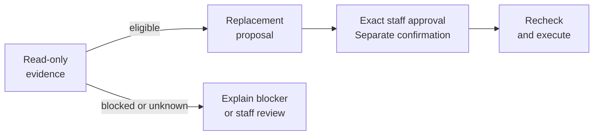
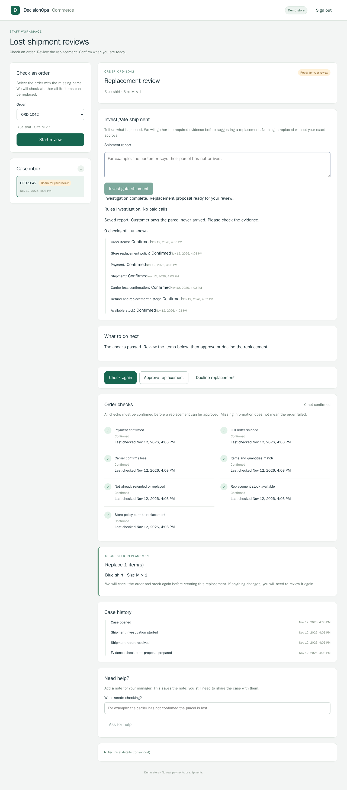

# DecisionOps Commerce

A fictional store's staff assistant for lost shipments: collect evidence, explain what
is still unknown, and prepare a replacement proposal. **People approve the exact
proposal and separately confirm execution.** PostgreSQL transactions recheck the
records, reserve stock and prevent duplicate replacements.



Deterministic checks lead to a proposal or review; staff must approve the exact
proposal and separately confirm before execution.

[How the optional mocked specialists gather evidence](docs/ARCHITECTURE.md).



## Five-minute demo

Requires Docker Engine and Docker Compose **2.24.4+**, an x86-64 host, approximately
4 GB available RAM and room for container images. No Python/Node install, sibling
worktree, private config or API key is required. First image/package retrieval can
take longer than five minutes. Dependencies and base images are locked.

```bash
git clone https://github.com/richardcheam/decisionops.git
cd decisionops
# While this release is a PR, check out release/commerce-portfolio.
git checkout release/commerce-portfolio
export COMMERCE_DEMO_PASSWORD='fictional-demo-password-only'
bash scripts/demo.sh build
bash scripts/demo.sh start
bash scripts/demo.sh health
```

Open **http://127.0.0.1:8133**. Sign in as **visitor**, using the password above.
`health` must return `status: ready`; PostgreSQL is internal and is not exposed on
the host. Use Docker-authorized access on your machine; do not run against another
Commerce project's database. The dedicated project is `decisionops-github-demo`.

1. Select **ORD-1042**, choose **Start review**, enter a short shipment report, and
   select **Investigate shipment**. Follow persisted evidence, including inventory.
2. Review the proposal. **Approve replacement → Confirm approval** binds it exactly.
   **Create replacement → Confirm replacement** is a separate action creating one
   fictional replacement. No agent may approve or execute it.
3. Select **ORD-HISTORY** and investigate: incomplete compensation history stays
   unknown, so review is required and no proposal/replacement is available.

Rules are the default and make no paid calls. To try the opt-in mocked specialists:

```bash
export COMMERCE_DEMO_MODE=mock-specialists
bash scripts/demo.sh start
# Start a new, unexecuted case. The UI says “Mocked specialists. No paid calls.”
```

An executed order remains compensated; changing modes does not erase that history.
Use an operator-controlled reset only after preserving evidence when a fresh demo
is needed. `reset` deletes **only this demo's fictional volume**:

```bash
bash scripts/demo.sh stop                         # retains data
# Optional fresh fictional records, never a routine restart:
COMMERCE_DEMO_RESET=decisionops-github-demo bash scripts/demo.sh reset
bash scripts/demo.sh start
# When finished:
bash scripts/demo.sh stop
```

**Verification limits:** the standard Dockerfiles and cached local build/start/browser
flow are tested as recorded in [release verification](docs/RELEASE.md). A completely
uncached host's registry/package retrieval is a separate requirement; no dependencies
are silently installed from another worktree. If the documented locked runtime images
already exist locally, `bash scripts/demo.sh build-cached` is an explicit network-free
build alternative, not a fresh-host verification claim.

## What is demonstrated

The optional typed LangGraph workflow coordinates bounded Order and Shipment
specialists. Mocked choices select scoped reads; PostgreSQL owns durable evidence,
leases and recovery. The deterministic join owns eligibility and proposal safety.

Saved local evidence demonstrates a valid proposal, partial failure routed to review
with peer evidence retained, and restart without specialist redispatch or a duplicate
proposal. Exact approval and separate execution were verified in the ordinary browser
flow. **Wrong-case evidence and actual conflicting database rows through the final
multi-agent join, and execution after restart, remain unverified.**

- [Specialist architecture and restart](docs/ARCHITECTURE.md)
- [Sanitized evidence and honest limits](docs/EVIDENCE.md)
- [Operator/deployment/rollback instructions](docs/RELEASE.md)
- [Detailed specialist review map](docs/commerce/MULTI-AGENT.md)
- [Staff guide](docs/commerce/STAFF-GUIDE.md) and [operational runbook](docs/commerce/RUNBOOK.md)

The real OpenAI adapters are preserved for separately authorized, manual-only
experiments. Startup, ordinary tests, CI and workers do not initiate paid calls.
Historical live Decisions investigations ended in review, not successful proposals.
The separate two-storefront browser benchmark does **not** drive this staff workflow;
its live Site A navigation ended with a rejected finish and five unexecuted cases.
No public Commerce deployment, real-shop connector or live multi-agent quality is claimed.

## Tests and preserved research

```bash
python3 -B -S scripts/commerce_ci_tests.py dependency-free
```

This reports every optional skip. PostgreSQL and browser tests run separately; a skip
is not a pass. See [release verification](docs/RELEASE.md) for their exact commands and
local versus CI results. No model weights are needed for routine checks.

The [historical diagnostic guide](docs/HISTORICAL-DIAGNOSTICS.md),
[findings](FINDINGS.md), and [offline viewer](https://richardcheam.github.io/decisionops/)
remain available. These synthetic development experiments do not establish Commerce
model quality or held-out generalization. Pages deploys that historical viewer, not
this application. [Archive index](docs/ARCHIVE.md) explains raw evidence retention.
