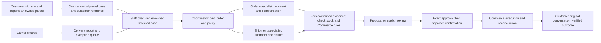

# DecisionOps Commerce

A customer reports a missing parcel and receives a case reference. Staff open that
same case, check the order and carrier records, and review a replacement proposal.
An authorized staff member approves the exact proposal and confirms creation
separately. The customer sees the verified result in their original conversation.

This is a portfolio demonstration for a fictional Paris-based online shop. Carrier
data and specialist choices are simulated. The browser flow, permissions, database
writes and recovery checks are implemented. A replacement record and stock
reservation do not establish shipment. Staff time savings need a merchant pilot.



## Run the demo

The single application definition is [`compose.yaml`](compose.yaml). Requires
Docker Engine/Compose2.24.4+, registry access, x86-64, about4GB free RAM. No API key
or model download is needed. Set your own local fictional demo password:

```bash
export COMMERCE_DEMO_PASSWORD='fictional-manager-demo-only'
export COMMERCE_HELPER_PASSWORD='fictional-investigator-only'
export COMMERCE_CUSTOMER_CAMILLE_PASSWORD='fictional-camille-demo-only'
export COMMERCE_CUSTOMER_ALEX_PASSWORD='fictional-alex-demo-only'
export COMMERCE_DEMO_MODE=mock-specialists
bash scripts/demo.sh build
bash scripts/demo.sh start
bash scripts/demo.sh health
```

1. Open **http://127.0.0.1:8133/customer** as **camille**. Select **DEMO-LYON** and
   choose **Report a missing parcel → Send message**. Keep the returned
   case reference. Leave the conversation open.
2. In a separate browser session, open **http://127.0.0.1:8133/staff** as **visitor**.
   Open the **same case reference** in the exception queue. The customer report,
   overdue alert and carrier records remain separate records.
3. Click **Investigate case**. Watch the order and shipment specialist tracks and sources.
   **“What’s still missing?”** reads progress without replacing a proposal or approval.
4. Review the proposal for **one demo-tote** from Lyon, including its ID, generation
   and content hash. Click **Approve replacement → Confirm approval**. Nothing has
   been created yet. Then **Create replacement → Confirm replacement**.
5. Staff see **Replacement confirmed**. Camille’s original conversation shows that
   the replacement was created and has **not been shipped**. Reloading retains the
   conversation and current outcome.
6. **alex** owns **DEMO-OVERDUE**, a Lille parcel still in transit. It shows why a
   late parcel does not qualify for the same replacement. The **staff** investigator
   can investigate, while **visitor** can approve and confirm.

Queue updates run in the background without chat. “Notifications” mean in-app case
updates. Reporting counts distinct parcels with verified delivered events in the
Paris week; open/overdue use all dispatched parcels, a separate cohort. A conflicting
parcel can have a delivered event and remain an operational exception.

`COMMERCE_DEMO_MODE=rules` retains the rules reference. Demo specialists make
**simulated choices**. Paid product/evaluation endpoints, real merchants/carriers,
MCP/A2A are outside this demonstration. LangSmith event export is opt-in and has
not been tested against the hosted service; default SDK tracing stays disabled. Production identity
integration is a later step; this local demo retains Basic auth and optional staff
and approver roles plus server-bound customer ownership.

Stop with `bash scripts/demo.sh stop`. Seeds are insert-once; replay preserves staff
work. A fresh demo has two cases. An existing volume keeps its original fixtures.
To switch to the two-case seed, first save any demo work you want to keep. The
following explicit reset deletes the fictional database:

```bash
COMMERCE_DEMO_RESET=decisionops-github-demo bash scripts/demo.sh reset
bash scripts/demo.sh start
```

See the [short presentation and local reproduction guide](docs/PORTFOLIO_DEMO.md),
[session checklist and checkpoint](docs/PORTFOLIO_CHECKPOINT.md),
[deployment, restore and prepared AWS staging](docs/PORTFOLIO_DEPLOYMENT.md), and
[prior delivery local launch](docs/DELIVERY_WORKSPACE.md),
[measured comparison and acceptance](docs/DELIVERY_VERIFICATION.md), and
[historical evidence](docs/EVIDENCE.md). The old evidence document records earlier
limitations and live runs; it is not evidence for this release's live model quality.
