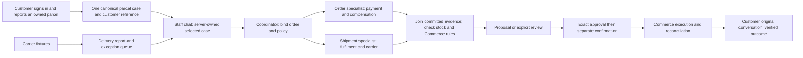

# DecisionOps Commerce

**DecisionOps is a support workspace for online shops.** Customers can ask about
an order or report a problem. Staff can investigate the same case, see which
checks are complete and what is missing, and approve a replacement when the
shop’s rules allow it.

> A customer says their parcel never arrived. Before sending another one, someone
> has to check the carrier’s updates, look for an earlier refund or replacement,
> and make sure the item is in stock. DecisionOps puts those checks in one staff
> workspace. If the records support a replacement, the system prepares a
> proposal. An authorized staff member approves the exact items and quantities,
> then separately confirms creation. The customer sees the result in the
> original conversation.

The customer assistant can show what someone ordered, track a parcel, or check
a case. For returns, refunds, and address changes, it explains how to get help
from staff.

## How many tools does it call?

The replacement workflow has **seven distinct read tools**. Two specialists can
call four of them, and the coordinator runs the other three.
[Workflow registry](decisionops/commerce/workflow_registry.py#L52-L62)

| Who checks | What they read |
|---|---|
| Coordinator | Order items and quantities, replacement policy, available stock |
| Order specialist | Payment, previous refunds and replacements |
| Shipment specialist | Shipment records, carrier evidence of loss |

In the recorded eligible-case run, the workflow made **seven investigation reads**
and then ran separate safety checks. The number of reads varies by case. The
customer and staff chats recognize **10 and 7 intents**, respectively, including
help and clarification. Intents route messages. The read tools check records.
[Recorded comparison](reports/delivery-workspace/comparison.json) ·
[Chat intents](decisionops/commerce/role_actions.py#L9-L13)

## What the three demo cases show

| Case | What happens |
|---|---|
| **Lyon** | The carrier confirmed loss. In the tested flow, staff created one replacement and reserved one item. Shipping would be a separate step. |
| **Lille** | The parcel is overdue and still in transit. Staff can explain the delay and hold off on a replacement. |
| **Saint-Denis** | The carrier records disagree. Staff review the discrepancy before any replacement can go ahead. |

The demo uses a fictional Paris-based shop and simulated carrier data. The quickstart
below simulates specialist choices and makes **zero model calls**. You can also run
the assistants with a local LLM. The browser workflow, permission checks, database
writes, and recovery are implemented. A merchant pilot would measure staff time
saved per case.
[Demo walkthrough](docs/PORTFOLIO_DEMO.md)



## Run the demo

The single application definition is [`compose.yaml`](compose.yaml). Requires
Docker Engine/Compose2.24.4+, registry access, x86-64, about4GB free RAM. No API key
or model download is needed. Set your own local fictional demo password:

```bash
export COMMERCE_DEMO_PASSWORD='fictional-manager-demo-only'
export COMMERCE_HELPER_PASSWORD='fictional-investigator-only'
export COMMERCE_CUSTOMER_CAMILLE_PASSWORD='fictional-camille-demo-only'
export COMMERCE_CUSTOMER_ALEX_PASSWORD='fictional-alex-demo-only'
export COMMERCE_DEMO_MODE=mock-specialists
bash scripts/demo.sh build
bash scripts/demo.sh start
bash scripts/demo.sh health
```

You can open the Docker demo at either `http://127.0.0.1:8133` or `http://localhost:8133`.

1. Open **http://127.0.0.1:8133/customer** as **camille**. Select **DEMO-LYON** and
   choose **Report a missing parcel → Send message**. Keep the returned
   case reference. Leave the conversation open.
2. In a separate browser session, open **http://127.0.0.1:8133/staff** as **visitor**.
   Open the **same case reference** in the exception queue. The customer report,
   overdue alert and carrier records remain separate records.
3. Click **Investigate case**. Watch the order and shipment specialist tracks and sources.
   **“What’s still missing?”** reads progress without replacing a proposal or approval.
4. Review the proposal for **one demo-tote** from Lyon, including its ID, generation
   and content hash. Click **Approve replacement → Confirm approval**. Nothing has
   been created yet. Then **Create replacement → Confirm replacement**.
5. Staff see **Replacement confirmed**. Camille’s original conversation shows that
   the replacement was created and has **not been shipped**. Reloading retains the
   conversation and current outcome.
6. **alex** owns **DEMO-OVERDUE**, a Lille parcel still in transit. It shows why a
   late parcel does not qualify for the same replacement. The **staff** investigator
   can investigate, while **visitor** can approve and confirm.

Queue updates run in the background without chat. “Notifications” mean in-app case
updates. Reporting counts distinct parcels with verified delivered events in the
Paris week; open/overdue use all dispatched parcels, a separate cohort. A conflicting
parcel can have a delivered event and remain an operational exception.

`COMMERCE_DEMO_MODE=rules` retains the rules reference. Demo specialists make
**simulated choices**. Paid product/evaluation endpoints, real merchants/carriers,
MCP/A2A are outside this demonstration. LangSmith event export is opt-in and has
not been tested against the hosted service; default SDK tracing stays disabled. Production identity
integration is a later step; this local demo retains Basic auth and optional staff
and approver roles plus server-bound customer ownership.

Stop with `bash scripts/demo.sh stop`. Seeds are insert-once; replay preserves staff
work. A fresh database starts with the three cases above. An existing volume
keeps its original fixtures. To switch to the three-case seed, first save any demo work
you want to keep. The following explicit reset deletes the fictional database:

```bash
COMMERCE_DEMO_RESET=decisionops-github-demo bash scripts/demo.sh reset
bash scripts/demo.sh build
bash scripts/demo.sh start
```

## Run the assistants with a local LLM

For a laptop walkthrough and a map of what you can edit, see the [local model guide](docs/LOCAL_MODEL.md).

In LLM mode, Ollama selects the customer and staff chat actions and the specialist
tool calls. DecisionOps reads the records and formats the replies. PostgreSQL and
the application still enforce case ownership, eligibility, exact approval, and
execution. If inference fails, chat reports that the model is unavailable and
investigations go to staff review.

For Docker, have an Ollama image available locally and set the path to an existing
Ollama model store. Keep the fictional credentials from the quickstart.

```bash
export COMMERCE_DEMO_MODE=llm
export COMMERCE_LLM_MODEL='your-installed-model:tag'
export COMMERCE_OLLAMA_MODEL_DIR='/absolute/path/to/ollama/models'
bash scripts/demo.sh build
bash scripts/demo.sh start
```

Set `COMMERCE_OLLAMA_IMAGE` if your local image has a tag other than
`ollama/ollama:latest`. Compose runs the model on the app’s internal network with
cloud features disabled. It checks that the model exists at startup. It uses the
model directory read-only and does not fetch images or weights.

If you run directly on the host, start local-only Ollama first, set
`COMMERCE_LLM_MODEL`, and pass `--mode llm` to the [local launcher](docs/PORTFOLIO_DEMO.md).
It defaults to `http://127.0.0.1:11434`. Use a warmed model that can return a short
JSON answer within five seconds. [Ollama structured outputs](https://docs.ollama.com/capabilities/structured-outputs)

## Where to start in the code

| If you want to follow… | Start here |
|---|---|
| How the app opens the staff, customer, or shop page | [Frontend entry point](frontend/src/main.tsx) |
| How staff sign in, open a case, and send approval or execution requests | [Staff workspace](frontend/src/staff/workspace.tsx) |
| How staff see the next step, order checks, and specialist evidence | [Case panel](frontend/src/staff/case-panel.tsx) · [Investigation panel](frontend/src/staff/investigation-panel.tsx) |
| How customers see their orders and report a problem | [Customer portal](frontend/src/customer.tsx) |
| How the server checks permissions and runs the replacement workflow | [Commerce API](decisionops/commerce/api.py) · [Workflow registry](decisionops/commerce/workflow_registry.py) |

## Technical evidence

See the [short presentation and local reproduction guide](docs/PORTFOLIO_DEMO.md),
[session checklist and checkpoint](docs/PORTFOLIO_CHECKPOINT.md),
[deployment, restore and prepared AWS staging](docs/PORTFOLIO_DEPLOYMENT.md), and
[prior delivery local launch](docs/DELIVERY_WORKSPACE.md),
[measured comparison and acceptance](docs/DELIVERY_VERIFICATION.md), and
[historical evidence](docs/EVIDENCE.md). The old evidence document records earlier
limitations and live runs; it is not evidence for this release's live model quality.
