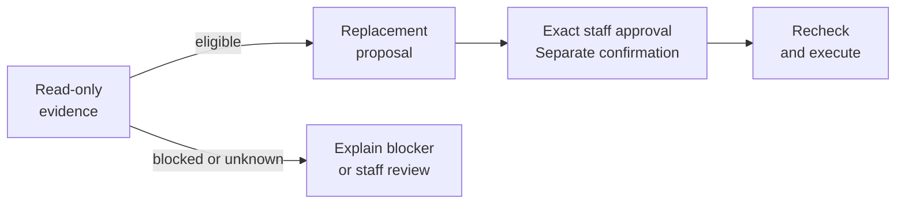

# DecisionOps Commerce

A local staff assistant for a fictional store's lost shipments. It gathers cited
evidence, proposes a replacement or explains the missing facts, and requires staff
to approve the **exact proposal** and separately confirm execution. PostgreSQL
rechecks records, reserves stock and prevents duplicate fictional replacements.



Deterministic checks lead to a proposal or review; staff must approve the exact
proposal and separately confirm before execution.

The final application uses one [`compose.yaml`](compose.yaml); verification fixtures
are separate under `tests/compose/`.

## Run the fictional demo

Requires Git, Bash, curl, Docker Engine and Compose **2.24.4+**, an x86-64 host,
about **4 GB available RAM**, and disk space for images. The first build needs
registry/PyPI/npm access; no host Python/Node, private configuration or API key.
Local rehearsal reused cached layers; fully uncached host retrieval remains a
separate prerequisite. Dependencies and base images are locked.

```bash
git clone https://github.com/richardcheam/decisionops.git
cd decisionops
export COMMERCE_DEMO_PASSWORD='fictional-demo-password-only'
bash scripts/demo.sh build
bash scripts/demo.sh start
bash scripts/demo.sh health
```

Open **http://127.0.0.1:8133**, sign in as **visitor** with that password, and select
**ORD-1042 → Start review → Investigate shipment**. Review gathered evidence, approve
the exact proposal, then separately confirm replacement creation. **ORD-HISTORY**
shows why incomplete compensation history requires review instead.

Rules are the default. For a new, unexecuted case, optionally select mocked specialists:

```bash
export COMMERCE_DEMO_MODE=mock-specialists
bash scripts/demo.sh start
# When finished; data is retained:
bash scripts/demo.sh stop
```

Changing modes does not erase compensation history. Reset is explicit and restricted
to this demo's fictional volume; see the operator guide. No paid calls or telemetry
are initiated by this demo, tests or CI. Live API use remains separately authorized
and manual-only. No public deployment or real-shop integration is claimed.

- [Architecture: specialist flow and recovery boundary](docs/ARCHITECTURE.md)
- [Operation, reset, checks and rollback](docs/RELEASE.md)
- [Evidence, screenshots and unverified scenarios](docs/EVIDENCE.md)
- [Archive and retained historical diagnostics](docs/ARCHIVE.md)

Mocked specialists demonstrate proposal, partial-failure review and restart without
redispatch or duplicate proposal. Exact approval/execution was checked in the ordinary
browser flow; final-join wrong-case/conflicting-row scenarios and execution after
restart remain unverified. Historical live API/browser investigations did not complete
successful proposals; they do not establish live multi-agent quality.
