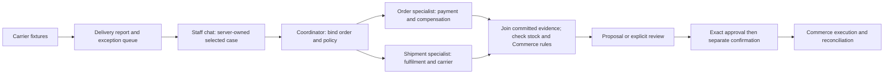

# DecisionOps Commerce

A local delivery workspace for a fictional shop dispatching from Paris to France.
Staff ask delivery questions, open an exception, and delegate a lost parcel to a
LangGraph coordinator and two specialists. Commerce checks seven conditions;
an approver reviews the exact proposal and separately confirms a fictional
replacement. PostgreSQL owns evidence, approvals, stock reservations and recovery.



## Run the demo

The single application definition is [`compose.yaml`](compose.yaml). Requires
Docker Engine/Compose2.24.4+, registry access, x86-64, about4GB free RAM. No API key
or model download is needed. Set your own local fictional demo password:

```bash
export COMMERCE_DEMO_PASSWORD='choose-a-local-demo-password'
export COMMERCE_DEMO_MODE=mock-specialists
bash scripts/demo.sh build
bash scripts/demo.sh start
bash scripts/demo.sh health
```

Open **http://127.0.0.1:8133**, sign in as **visitor**, and follow this walkthrough:

1. Ask **“How many deliveries did we complete this week?”** Fresh seed:3 completed,
   9 open,8 overdue and9 exceptions. The report shows Paris-local date bounds and freshness.
2. Ask **“Were there any problems?”** Open the **DEMO-LYON** parcel from a report
   link or the queue. Its overdue trigger and verified carrier loss are distinct facts.
3. Ask **“Fix this”**. Watch both specialist tracks and the cited evidence.
   **“What’s still missing?”** reads progress without starting another run.
4. Review the proposal ID and content hash, approve it, then separately confirm
   replacement creation. The completed result comes from the execution record.
5. Open **DEMO-CONFLICT**, **DEMO-HISTORY**, **DEMO-REPLACED**, or **DEMO-OUTAGE**
   for safe review/blocker examples. **DEMO-SPLIT** requires explicit parcel selection
   and unsupported partial replacements stay in review.

Queue updates run in the background without chat. “Notifications” mean in-app case
updates. Reporting counts distinct parcels with verified delivered events in the
Paris week; open/overdue use all dispatched parcels, a separate cohort. A conflicting
parcel can have a delivered event and remain an operational exception.

`COMMERCE_DEMO_MODE=rules` retains the rules reference. Demo specialists make
**simulated choices**. Paid product/evaluation endpoints, real merchants/carriers,
MCP/A2A and telemetry exports are outside this release. Production identity
integration is a later step; this local demo retains Basic auth and optional staff
and approver roles.

Stop with `bash scripts/demo.sh stop`. Seeds are insert-once; replay preserves staff
work. For a new current-week launch, explicitly reset only the fictional demo volume:

```bash
COMMERCE_DEMO_RESET=decisionops-github-demo bash scripts/demo.sh reset
bash scripts/demo.sh start
```

See [isolated local launch, checks and evidence](docs/DELIVERY_WORKSPACE.md),
[measured comparison and acceptance](docs/DELIVERY_VERIFICATION.md), and
[historical evidence](docs/EVIDENCE.md). The old evidence document records earlier
limitations and live runs; it is not evidence for this release's live model quality.
