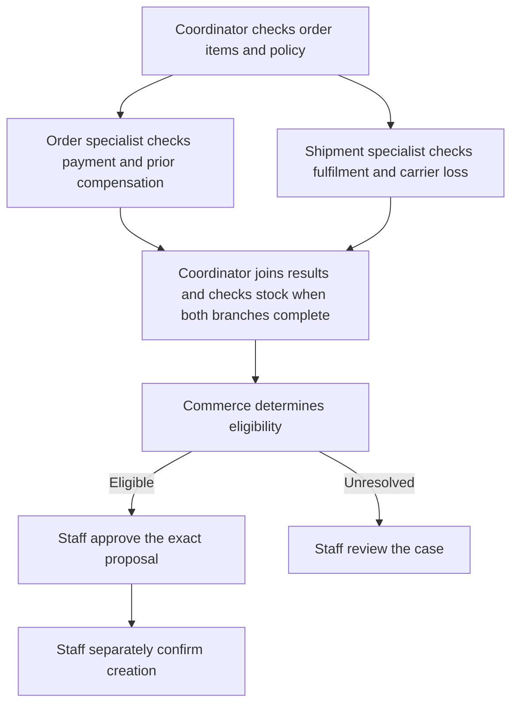

# DecisionOps architecture

DecisionOps connects a customer conversation to a staff case. The application
uses customer reports and carrier updates to find the case, then checks business
records before it offers a replacement. PostgreSQL stores the case and its
history. React displays progress and FastAPI checks identity and access.

[Run the demo](PORTFOLIO_DEMO.md) · [Set up a local model](LOCAL_MODEL.md)

## Who reads what

| Role | Reads or decisions |
|---|---|
| Customer chat router | Selects a supported action for the signed-in customer, such as checking an owned order or reporting a missing parcel |
| Staff chat router | Selects a supported action such as showing overdue deliveries, checking a case or starting an investigation |
| Order specialist | `payment`, `compensation_history` |
| Shipment specialist | `fulfilment`, `carrier_loss` |
| LangGraph coordinator | `order_manifest`, `replacement_policy`, `inventory` |

There are seven available investigation read tools. The coordinator reads the
manifest and replacement policy first. The two specialist branches can then run
in parallel. The shipment specialist checks fulfilment before carrier loss.
The coordinator reads stock after both branches complete and passes the committed
evidence to Commerce for an eligibility check. If the evidence is missing, stale
or conflicting, Commerce can stop the case for review. A confirmed blocker such
as earlier compensation can also prevent a proposal.
[Tool registry](../decisionops/commerce/workflow_registry.py) ·
[Specialist execution and join](../decisionops/commerce/multi_agent.py)

## Modes and authority

| Mode | What selects actions |
|---|---|
| `mock-specialists` | The README quickstart. Built-in chat routers and simulated specialist choices run without a model. |
| `rules` | The launcher default when no mode is set. Built-in chat routers and a fixed investigation policy. |
| `llm` | One local Ollama model can select actions for both chats and both specialists. The app checks each choice against the role’s allowed actions. An unavailable model produces a chat error or sends the investigation to staff review. |
| `mock-decisions` | An API and test mode that simulates decision responses. The Compose launcher exposes the other three modes. |

A model call selects an action. A read fetches evidence, and Commerce decides
eligibility from that evidence. This means a single case can involve chat
decisions, specialist choices, and application-driven reads or rechecks. The
number of reads and model calls varies with the case, mode and retries.
The integration tests use a local protocol stub. Live-model accuracy and latency
remain unverified. [Role actions](../decisionops/commerce/role_actions.py) ·
[Local transport tests](../tests/test_commerce_local_llm.py)

## Approval, confirmation and recovery

The API checks who owns an order or case. A customer report records what the
customer says, while carrier and order records establish the business facts.
Commerce checks the proposal’s ID, generation and content hash when an authorized
staff member approves it. Separate confirmation requests creation. The execution
worker rechecks the records and uses a database transaction to create one replacement
record and reserve stock. Reconciliation checks the saved result that the customer
sees in their original conversation.

The investigation worker records completed reads and tool decisions in PostgreSQL.
LangGraph checkpoints progress. A restarted worker reconstructs its progress from
committed records and reuses completed work. An uncertain model decision can
require staff review. The execution worker checks for previously committed effects
so a repeated confirmation cannot reserve stock a second time.
[Browser acceptance](../frontend/customer-tests/journey.spec.ts) ·
[Recovery walkthrough](../scripts/commerce_delivery_recovery.py)

## Code map

| To follow | Start here |
|---|---|
| Customer and staff pages | [Frontend entry](../frontend/src/main.tsx), [customer portal](../frontend/src/customer.tsx), [staff workspace](../frontend/src/staff/workspace.tsx) |
| Identity, case access and endpoints | [Commerce API](../decisionops/commerce/api.py), [customer API](../decisionops/commerce/customer_api.py) |
| Investigation admission and progress | [Staff investigations](../decisionops/commerce/staff_investigations.py), [LangGraph workflow](../decisionops/commerce/multi_agent_workflow.py) |
| Eligibility and approval | [Eligibility rules](../decisionops/commerce/eligibility.py), [cases](../decisionops/commerce/cases.py) |
| Creation, reservation and result checks | [Execution](../decisionops/commerce/execution.py), [worker](../decisionops/commerce/worker.py) |
| Model configuration and prompts | [Local model transport](../decisionops/commerce/local_llm.py) |

[Maintainer and historical references](ARCHIVE.md)

## Returns and missing parcels

Both workflows use the same customer sign-in, owned-order access checks, staff
workspace, and approver permissions. Customers see the outcome in the
conversation where they asked for help. Staff review a proposal bound to the
exact request. They approve and confirm separately.

A missing-parcel case binds a parcel and uses shipment evidence, the specialist
graph, replacement rules, and a worker that reserves stock. A return case binds
one item from an owned order. It has its own queue, policy reads, proposal, and
authorization record. Its rules check verified delivery, the 30-day window,
item eligibility, and prior returns or refunds. Missing or conflicting evidence
stays visible for staff review. The customer assistant can route a question to
the eligibility check. Filing takes an explicit request with an exact item.

At confirmation the return service rechecks the evidence and checks the saved
approval inside a PostgreSQL transaction. The same case can produce one
authorization. Returns in this phase stop at authorization. The shop handles
refunds, shipping labels, pickup, warehouse receipt, and stock outside this flow.

## Catalog image cases

Catalog uses the same staff sign-in and approver role. The workflow reads the
listing, the images verified for its SKU, and the verified supplier record.
It opens a proposal only when those records justify a same-SKU relink. Approval
binds the exact old and new image IDs, listing version, and evidence. Separate
confirmation rechecks the evidence and version, writes one relink and verifies
the saved image ID. Conflicts leave the listing unchanged.

The benchmark separates pixel descriptions and uncertainty from scoped catalog
reads. The product uses deterministic authorization. Supplier evidence lives
in the catalog database, so the workflow has no document retrieval step.
