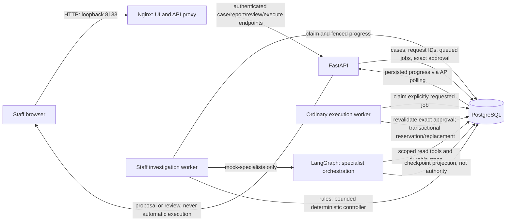
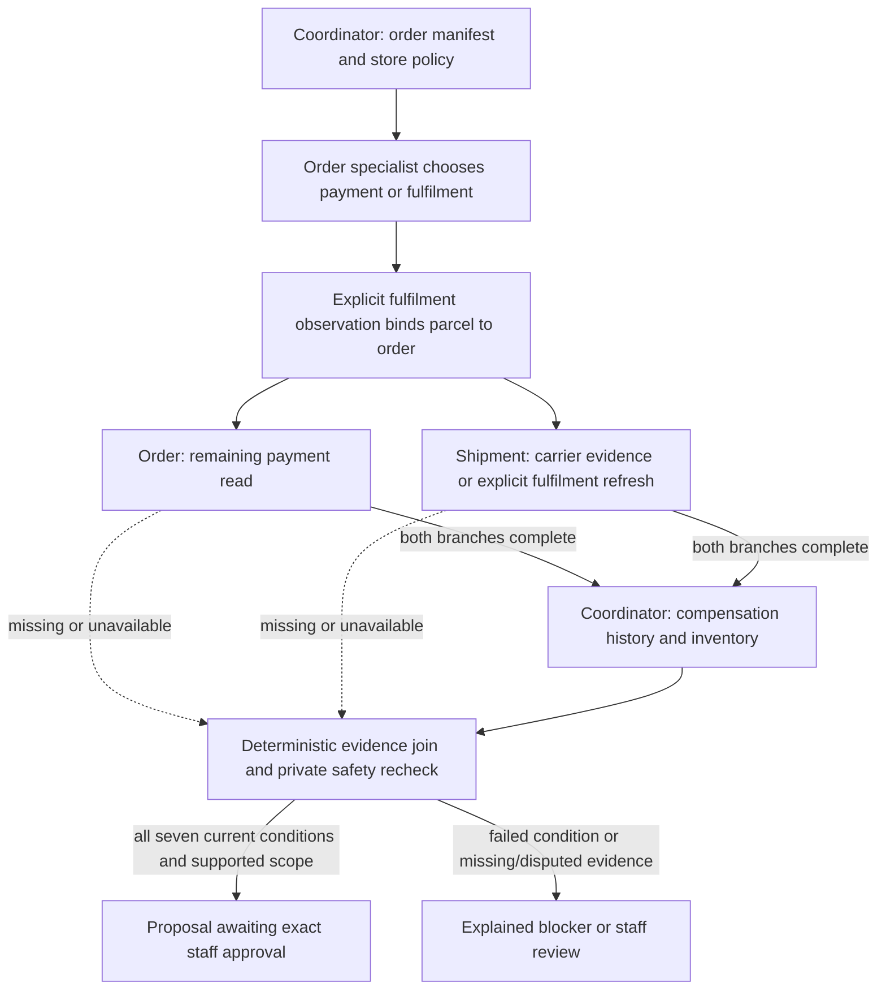

# Commerce architecture

The supported demo uses fictional PostgreSQL records. Rules are the default; the
optional specialists use mocked choices. Neither mode ships goods or contacts customers.

Browser requests enter `api.py`; `staff_investigations.enqueue` admits/coalesces
requests and invalidates an older proposal/approval on genuinely new investigation.
`staff_investigations.work_once` claims the explicit specialist job partition, or the
legacy rules partition. The browser polls committed state; it remains usable during work.
`cases.review_case` checks generation/proposal/hash. A separate `/execute` action queues
an ordinary job; `execution.execute` revalidates, locks and commits fictional effects.
Model output never has approval or execution authority.

Only P/S can overlap. Tracking depends on manifest, fulfilment and replacement policy;
there is no hidden all-records read inside a selected specialist tool. Order owns
payment/fulfilment; Shipment owns carrier evidence and an explicit fulfilment refresh.
Other mandatory conditions remain coordinator reads. On partial branch failure, those
completion reads are skipped and the join discloses the remaining unknowns. Tracking alone cannot establish
eligibility. See `adaptive_tools.DEPENDENCIES` and `PROJECTIONS` for exact SQL fields.

`multi_agent_workflow.py` defines actual graph nodes/fan-out/join. PostgreSQL commits
immutable observations, reservation/disposition history, attempts, case revision and
lease tokens. Checkpoints contain reconstructable progress, not ownership. On restart,
committed branch calls are reused; uncertain decisions are not redispatched. No inference
or tool wait holds a business transaction. `multi_agent.read` validates scope/dependencies;
`multi_agent.join` calls the existing deterministic proposal safety path. Fresh safety
reads cannot fill an unread evidence gap or become policy observations.

The [evidence summary](EVIDENCE.md) links success, partial failure and restart to tests.
It distinguishes admission-only wrong-case checks from unverified final-join scenarios.
Mocked local specialists have no demonstrated speed/quality gain over fixed-order rules.
Langfuse is not installed or exporting telemetry; local redacted summaries suffice.
Deep Agents would duplicate this bounded controller and is omitted. The historical
browser navigation benchmark is separate and its page evidence cannot authorize Commerce.
