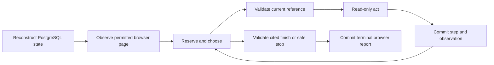

# Bounded browser graph and trace integration — proposed, not implemented

The local browser harness/model-free gate comes first. An independently authorized
API evaluation can run before this integration. Current browser runs use immutable
local audit exports and an fsync-persisted single-use budget ledger; they do **not**
already have PostgreSQL recovery or Langfuse delivery.

## Reuse against actual source

- `decisionops/commerce/adaptive_workflow.py`: StateGraph/PostgresSaver projection,
  authoritative reconstruction from domain steps/reservations, distinct thread/schema,
  bounded cursor statement/lock waits, explicit checkpoint failure, stop-event plumbing.
  This is the stronger pattern to reuse, rather than the older `workflow.py` projection
  whose checkpoint connection does not have the same finite SQL bounds.
- `adaptive_jobs.py`: token-fenced claims, unexpired renewal and partitioned job actions.
- `adaptive_accounting.py`: immutable request/context binding, prepare/claim outside
  inference, dispatch_count=1, known-result settlement and uncertain reservations.
- `adaptive_investigations.py`: versioned immutable observations, active selection,
  explicit scope/freshness checks and private proposal safety reads.
- `workflow.py`: staff review interrupts consult actual durable approval; graph input
  cannot approve. Retain its Commerce behavior, do not graft browser evidence into it.

These modules are not drop-in browser runners: their actions, DB tables and validation
are Commerce task-specific. Reuse the pattern and small bounded checkpoint helpers;
keep browser state in a **new namespace**, not synthetic Commerce cases/jobs/evidence.
The existing route_investigated_case and approval/execution APIs stay intact.

## Smallest implementation slice after review

One migration in a separate environment adds browser_runs, browser_steps,
browser_observations, browser_calls and a small trace outbox. A browser run binds
request/version, fixture/controller/source/config hashes, immutable absolute deadline,
caps and origin scope. Unique `(run, sequence)`, `(run, decision ordinal)` and one
active owner serialize progression. Durable call states reserve → dispatching →
known/uncertain are independent of action application. Observation/control epochs,
current sequence and pending attempt token are updated by compare-and-swap under
short locks. Read-only browser tools never write business records.

Use a new job partition `browser-investigation/v1`, excluded by existing worker claim
filters. One explicitly invoked browser worker owns one context, with finite lease,
fencing token and immutable deadline. Runtime token/events/browser handles never enter
checkpoint authority. Reuse bounded read/write helpers, with remaining run/lease
limits and separate 5-second metadata/checkpoint bound. No DB locks or transactions
span SDK, browser navigation, checkpoint/export network calls or staff pauses.

Graph nodes:

Each node first consults domain disposition, commits its domain transition, then
projects checkpoint state. State is run ID, domain sequence/context version, phase,
committed observation/call IDs and next admissible operation, not raw secrets, DOM,
ownership tokens or evaluator answers. Thread `browser-investigation/v1:<run uuid>`
and schema `browser_graph_<environment hash>` cannot collide with Commerce graphs.
PostgreSQL remains authoritative if checkpoint write fails or checkpoints disappear.
The checkpointer records progression; it is not a second dispatcher or permission store.

## Resume, uncertainty and browser lifetime

After restart, reconstruct caps, absolute deadlines, reservations, terminal outcomes
and last committed sequence from domain rows. Never reset counters from a checkpoint.
A known settled decision and committed action are not repeated. An uncertain API call
is not redispatched: retain its reservation and require explicit stop/recovery.
A reserved, never-dispatched request may be abandoned as known zero work under an
explicit operator disposition; it is not an automatic model retry.

A browser process/context is ephemeral: checkpointing its reference strings does not
restore a live DOM. Invalidate all control handles on restart. If a read-only action
was interrupted, an operator may authorize a **new counted** re-observation attempt
within the original deadline/caps. Restore from the start URL through recorded
observed-link history only, revalidate every guard and count each reread. A changed
page or unsupported disclosure restoration stops for review; do not pretend old DOM
handles remain current or replay model dispatch to recreate navigation. No scripted
site recipe becomes a policy feature. Terminal reports are insert-once and recovery
projects them without new dispatch, finishing again or refreshing their evidence.

Lease loss, SIGTERM or deadline stops the owned process group/browser container.
Late results are retained as unapplied audit records; newer owner/context pointers
remain unchanged. Dispatched calls without a known result remain uncertain. Setup,
inspect, resume and recover are separate operator commands with no automatic startup
API dispatch. Existing approval/execution locks and exact-proposal checks are untouched.
Browser reports remain untrusted page claims, never Commerce evidence attestations.

## Trace contract and redaction

One trace/root per browser run; nested spans for observe, reserve/dispatch/result,
validation, navigation/disclosure, durable commit and terminal report. Deterministic
IDs derive from run/step IDs so a projection retry/export cannot duplicate effects.
Examples (based on scripted gate evidence, **not live-model results**):

- Success A1: initial history observation → choice of observed order link → order
  observation → tracking-link choice → current parcel/event observation → cited
  evidence_found. Show field/quote bindings, 3 tool observations and browser-only
  terminal result. No proposal/approval/execution span exists.
- Safe stop G1: dashboard → receipt → opened parcel → order mismatch OR-9055 versus
  task OR-9054 → wrong_binding. Trace identifies the opened block and rejected binding,
  remaining requested shipment unknown. A safe stop is not task completion.
  G2 additionally shows actual 503/navigation_failure and partial order evidence;
  distinguish it from absent carrier evidence and from a blocked request.

Raw fictional audit remains local. A pure **allowlist projection before the outbox**
creates export records: opaque run/step/span IDs, task/tool names, source/config
versions, schema versions, count/cap/remaining values, safe path templates (no query,
userinfo, customer IDs), selected action/control role, result/validation/error codes,
latency, native numeric usage, pricing version and labelled cost estimates. Export
only hashes/lengths of reports, observations and citations by default. No report text,
order/customer/parcel IDs, credentials, headers/cookies, network bodies, DOM, private
staff records, evaluator answers or SDK error messages go to telemetry. If future
review approves fictional quoted content, it must be an explicit additional profile,
not a general raw-payload exporter. Redaction tests use planted secret/PII canaries.

No automatic OpenAI/LangChain instrumentation: it could capture prompts before the
allowlist. Apply a second export-boundary masking hook as defense in depth. Exporter
failure is a bounded outbox delivery error, never a reason to repeat domain effects.
Disabled/export-to-local-JSON is the default. Off-host Langfuse requires separate
approval of endpoint, credentials, retained fields and retention/access policy.

## Dependencies/services and acceptance

No new dependency for the LangGraph portion: existing commerce lock already includes
LangGraph, PostgreSQL checkpointer, psycopg and SQLAlchemy. No LangChain is needed.
Langfuse is absent today: propose one **optional pinned Langfuse Python SDK profile**,
Python v5/server v4 compatibility per current docs; exact version selected/locked in
the future integration change after compatibility checks.
No dependency installed or version claimed in this plan. Start with a local redacted
JSON outbox/sink test; an actual Langfuse service is a separate opt-in. Full self-hosted
Langfuse v4 requires more than the current PG container (ClickHouse, Redis, blob/S3
storage and web/worker components); do not add that stack merely to inspect six runs.
A separately approved hosted project avoids those local services but exports data.

Acceptance checks before enabling graph/trace execution:

1. Reconstruct after every boundary: reservation, before dispatch, after result,
   after action commit, terminal publication and failed checkpoint. Domain counts and
   dispatch count remain identical; uncertain calls never redispatch.
2. Delete only test checkpoints and rebuild the projection from domain rows. Terminal
   report/steps remain byte-equal; no actions/calls are repeated.
3. Real SQL checkpoint lock hits bounded timeout; committed domain state survives.
   Concurrent claims, lease expiry/renewal, stale token/result and shutdown cannot
   advance a newer owner or extend deadline. Ordinary Commerce workers claim zero
   browser jobs.
4. Restart drops current handles; old refs reject. Explicit counted rereads cannot
   exceed caps or silently replace changed evidence. Test unsupported restoration.
5. Replay success and safe-stop local audits through the redacted outbox. Assert
   parent/child spans, error cause and quote-hash provenance, no secret canaries or
   private fields. Duplicate delivery is bounded/idempotent; sink failure does not
   trigger dispatch/publication. With tracing disabled, outbound connections = zero.
6. Keep required Commerce approval/execution/provider regressions and model-free
   harness tests passing. A browser citation can never satisfy a proposal prerequisite.

References: [LangGraph persistence](https://docs.langchain.com/oss/python/langgraph/persistence),
[durable execution](https://docs.langchain.com/oss/python/langgraph/durable-execution),
[Langfuse masking](https://langfuse.com/docs/observability/features/masking),
[self-hosting](https://langfuse.com/self-hosting). These describe library/service
capabilities; the authority and redaction rules above are this project's design.
