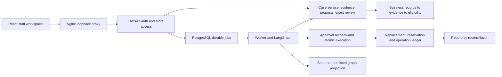

# DecisionOps Commerce — local operator guide

Working local release: fictional lost-shipment investigation, exact staff review,
atomic replacement/reservation and verified result. Rules mode is the default;
there is no open-ended message interpretation or paid inference.

For nontechnical store staff, use [STAFF-GUIDE.md](STAFF-GUIDE.md). They use the
browser, product names, order checks and explicit confirmation buttons. They do
not need this deployment guide, a terminal, an AI agent or infrastructure access.

Start here, from your checkout (replace the example path):

```bash
cd /path/to/decisionops
python3 -B scripts/commerce_local_setup.py
docker compose --profile app build
docker compose --profile app up -d --wait
curl --fail http://127.0.0.1:8080/health
```

Open http://127.0.0.1:8080. Username operator; read the current private .env password
locally using the runbook. Do not share it. The original seeded order's tracking
can become stale; investigate the actual evidence rather than resetting the seed.
Fresh eligible end-to-end demonstrations run in disposable schemas.



The graph schedules progress; the domain service enforces permission. A true
eligibility assessment permits a proposal, not an action. Staff review binds exact
generation/hash/evidence. Execution locks and rechecks relevant records, then
commits all writes together. The operation ID lets reconciliation resolve a lost
response without a second reservation. A trace/checkpoint cannot prove execution.

| Need | Relevant files |
| --- | --- |
| Source review, fresh checkout, CI and invariant tests | [REVIEW.md](REVIEW.md) |
| Startup, failures, patches, recovery, safe shutdown | [RUNBOOK.md](RUNBOOK.md) |
| Browser-only instructions for nontechnical staff | [STAFF-GUIDE.md](STAFF-GUIDE.md) |
| Owner versus agent work and verification history | [LEARNING.md](LEARNING.md) |
| Choices, unsupported scope and dependent milestones | [DECISIONS.md](DECISIONS.md) |
| Proposed API/AWS costs; no approval or provisioning | [SPENDING-PLAN.md](SPENDING-PLAN.md) |
| Original contract and evidence checks | decisionops/commerce/eligibility.py, evidence.py |
| Business schema and record-derived facts | schema.py, read_tools.py, migrations/versions/ |
| Case/review/transaction guarantees | cases.py, execution.py |
| Durable scheduling and recovery | jobs.py, workflow.py, worker.py |
| Staff boundary and interface | api.py, frontend/src/main.tsx |
| Disposable demonstrations | scripts/commerce_*_walkthrough.py |

Local milestones completed and tested: normalized/evidence assessment, PostgreSQL
read tools, immutable proposals, exact review and atomic action, durable worker,
authenticated workspace, browser workflow, isolated backup restore and same-code
configuration rollback. Source review and separate CI jobs are documented in REVIEW.md. See the pull
request checks for the current GitHub result; local evidence is in LEARNING.md.

Remaining milestones: optional decision/language providers with durable budget
controls and fake fault tests; independently reviewed held-out evaluation; cloud
TLS/identity/IaC/deployment and encrypted off-host backups. Paid experiments and
AWS provisioning require approval of the concrete plan and missing account facts.
Stock release/cancellation and real external fulfilment are outside this release.

All recent tests, image builds, rotations and demonstrations were agent-executed.
No independent owner mastery is claimed. Optional participation later can use a
real task: inspect a case timeline, restart a worker, reproduce the backup restore
or diagnose readiness using the documented commands.
