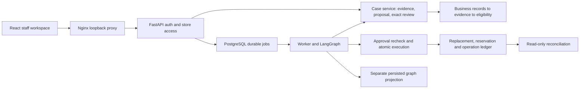

# DecisionOps Commerce — local operator guide

**Current supported demo:** [five-minute root quickstart](../../README.md),
[architecture](../ARCHITECTURE.md),and [release operation](../RELEASE.md).
Older worktree-specific commands below describe historical operation;they are not
prerequisites for the supported GitHub demo.

Working local release: fictional lost-shipment investigation, exact staff review,
atomic replacement/reservation and verified result. Rules mode is the default;
there is no open-ended message interpretation. Routine operation uses no paid
inference; optional API investigations require an explicit manual RUN LIVE TEST.
See the [current handoff](HANDOFF.md), [actual Decisions walkthrough](DECISIONS-LIVE-WALKTHROUGH.md)
and [evidence index](../../reports/commerce-evidence/INDEX.md).

For nontechnical store staff, use [STAFF-GUIDE.md](STAFF-GUIDE.md). They use the
browser, product names, order checks and explicit confirmation buttons. They do
not need this deployment guide, a terminal, an AI agent or infrastructure access.

For a new local rules stack, use [the isolated startup commands](HANDOFF.md#starting-the-rules-application-safely).
They assign a separate Compose project, images, ports and volume. Do not apply
current migrations to the original running migration-0004 application. Startup
commands were not executed during wrapup.

For that isolated stack open http://127.0.0.1:8087. The original stack remains on 8080. Username operator; read the current private .env password
locally using the runbook. Do not share it. The original seeded order's tracking
can become stale; investigate the actual evidence rather than resetting the seed.
Fresh eligible end-to-end demonstrations run in disposable schemas.

The graph schedules progress; the domain service enforces permission. A true
eligibility assessment permits a proposal, not an action. Staff review binds exact
generation/hash/evidence. Execution locks and rechecks relevant records, then
commits all writes together. The operation ID lets reconciliation resolve a lost
response without a second reservation. A trace/checkpoint cannot prove execution.

| Need | Relevant files |
| --- | --- |
| Source review, fresh checkout, CI and invariant tests | [REVIEW.md](REVIEW.md) |
| Startup, failures, patches, recovery, safe shutdown | [RUNBOOK.md](RUNBOOK.md) |
| Browser-only instructions for nontechnical staff | [STAFF-GUIDE.md](STAFF-GUIDE.md) |
| Owner versus agent work and verification history | [LEARNING.md](LEARNING.md) |
| Choices, unsupported scope and dependent milestones | [DECISIONS.md](DECISIONS.md) |
| Proposed API/AWS costs; no approval or provisioning | [SPENDING-PLAN.md](SPENDING-PLAN.md) |
| Original contract and evidence checks | decisionops/commerce/eligibility.py, evidence.py |
| Business schema and record-derived facts | schema.py, read_tools.py, migrations/versions/ |
| Case/review/transaction guarantees | cases.py, execution.py |
| Durable scheduling and recovery | jobs.py, workflow.py, worker.py |
| Staff boundary and interface | [Commerce API](../../decisionops/commerce/api.py), [staff workspace](../../frontend/src/staff/workspace.tsx) |
| Disposable demonstrations | scripts/commerce_*_walkthrough.py |

Local milestones completed and tested: normalized/evidence assessment, PostgreSQL
read tools, immutable proposals, exact review and atomic action, durable worker,
authenticated workspace, browser workflow, isolated backup restore and same-code
configuration rollback. Source review and separate CI jobs are documented in REVIEW.md. See the pull
request checks for the current GitHub result; local evidence is in LEARNING.md.

Optional operator-only fake decision routing and a durable simulated budget ledger
are available in this branch; see RUNBOOK.md. The browser/worker still use rules.
Adaptive per-tool investigation and optional API decision adapters are now implemented
on the retained local branch. Browser/API/ordinary-worker defaults remain unchanged.
The actual Decisions adapter calls POST /v1/decisions; both authorized live API
investigations stopped early in review. See HANDOFF.md for exact local versus CI
verification and unfinished Stage 5 scope.

Remaining milestones: resolving early-review behavior and the cached-pilot monitor
failure, real invoice reconciliation, language capabilities only if separately scoped,
independently reviewed held-out evaluation; cloud
TLS/identity/IaC/deployment and encrypted off-host backups. Paid experiments and
AWS provisioning require approval of the concrete plan and missing account facts.
Stock release/cancellation and real external fulfilment are outside this release.

Latest mocked/local tests were agent-executed. Richard personally executed the two
retained live API terminal investigations; no replacement approval/execution occurred
in those runs. Historical test/build attribution remains in LEARNING.md.
No independent owner mastery is claimed. Optional participation later can use a
real task: inspect a case timeline, restart a worker, reproduce the backup restore
or diagnose readiness using the documented commands.

Optional operator routing now supports cached, offline CPU Laya and GLiClass,
as well as rules and fake providers. Browser/API/worker remain rules-only.
See [RUNBOOK](RUNBOOK.md#optional-cached-local-laya-and-gliclass-routing) and
[measured integration results](../../reports/commerce-local-providers-20261014/README.md).
Both models requested review on the only meaningful two-choice input, disagreeing
with the rules reference. This is integration evidence, not a quality benchmark.

The separate [two-storefront browser harness](BROWSER-HARNESS.md) investigates only
fictional rendered customer pages. Its model-free checks do not demonstrate model
navigation. Browser evidence cannot authorize Commerce actions. A bounded API
comparison and [graph/trace integration](BROWSER-GRAPH-TRACE-PLAN.md) are proposed
separately; live calls require explicit spending approval.

Start the current offline portfolio candidate with the
[engineer/reviewer walkthrough](https://github.com/richardcheam/decisionops/blob/e311fe0e02a0386e86d400fb417147155847da02/docs/commerce/PORTFOLIO-RC.md). It distinguishes the rules staff
workflow, separate mocked browser navigation and preserved real protocol failure.

For the opt-in, local mocked specialist integration, see
[the bounded-specialist reviewer/deployment guide](MULTI-AGENT.md). Rules remain
the default; this mode is separate from the browser benchmark harness and its
verification is pending.
