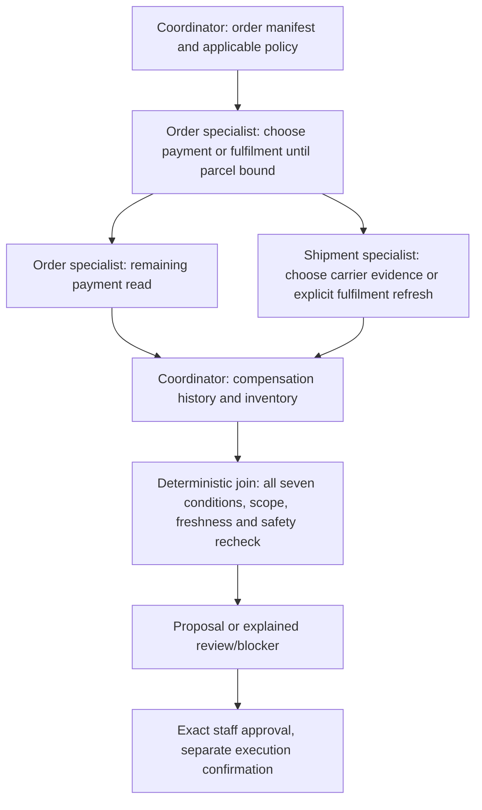

# ADR: bounded Commerce specialists, not a dynamic supervisor

Decision date / sources checked: 13 November 2026. Baseline d62d579, isolated branch
feat/commerce-multi-agent. No new dependency, live inference or telemetry export.

## Decision and alternatives

Keep rules and the existing single adaptive controller as the application default.
Add an opt-in `mock-specialists` staff mode using the installed LangGraph and existing
PostgreSQL authority. Use a typed graph with two bounded tool-selecting specialists,
not open-ended conversation or an LLM supervisor. This is an engineering dependency
choice, not a benchmark claim or evidence that more agents improve model quality.

| Approach | Fits here | Cost/failure tradeoff |
|---|---|---|
| One tool-using controller | Existing baseline: seven explicit reads, one durable loop | Simplest; fewer coordination records; already adequate for fictional cases |
| Dynamic supervisor | Useful when subtasks must be discovered dynamically | Here requirements/dependencies are known; adds delegation decisions, uncertain calls and recovery states with no demonstrated benefit |
| Typed graph and bounded specialists | Selected opt-in demonstration: scoped ownership, actual decisions and independent payment/tracking reads | More ledger/checkpoint complexity; overlap only independent reads; no latency/business-value claim without measurement |

Only C and D may overlap, after manifest, policy and selected shipment binding exist.
They use separate read-only transactions. Fulfilment is an explicit carrier dependency;
we do not pretend it is independent. No specialist owns stock, compensation permission
or eligibility. The coordinator collects the remaining mandatory conditions explicitly.
A tracking result alone cannot propose. Unsupported/missing binding ends in review.

## Boundary contracts and authority

- Shared identity is an immutable case request plus case generation/revision, manifest
  observation and the selected fulfilment/parcel observation. Parent run deadline240s,
 12 tool/16 decision attempts, two attempts per tool remain. Staff report <=2000 UTF-8
 bytes. One active run per case stays enforced by existing constraints/admission.
- Order specialist owns `fulfilment` and `payment`; Shipment owns `carrier_loss` and
 an explicitly selected `fulfilment` refresh, at most once under the existing2/tool cap.
 The initial Shipment choice can select carrier evidence or verify binding again;
 Order can prioritize payment versus fulfilment. Mock choices are persisted and
 validated, not replaced by a deterministic fallback or inferred facts.
- Typed policy requests contain task/specialist, permitted normalized observations,
 allowed actions, remaining caps and rejection feedback. Run/case IDs, hashes, versions
 and ownership remain audit bindings, not decision features. No sibling facts outside
 a specialist's ownership/dependencies enter its context. Each specialist <=4 choices,
 60s branch time,5s decision, bounded tool SQL waits. No lock/transaction spans choosing.
- Typed results reference observations and statuses, never authorize a business action.
 Status distinguishes complete evidence, missing/unavailable, stale, conflict, review
 and uncertain work. Derivations use the existing projected PostgreSQL read tools.
 Join independently reconstructs History, validates current scope/dependencies and
 uses existing private safety rereads + legacy attestation before proposal creation.
 It cannot fill missing specialist evidence with safety reads.
- New branch-call ledger binds request/config, generation/revision, dependencies,
 creation/dispatch token, immutable deadline and ordinal. Reserve count before model
 dispatch; known result persists once; read attempt reserves separately. Application
 is separately fenced. SQL observation/active-pointer/branch disposition commit
 atomically with immutable adaptive steps; sibling context changes are allowed only
 when the precise dependency versions remain current. No arbitrary newest record.

## Recovery, graph and traces

New `multi_agent_investigate/v1` action is excluded from legacy claims; only the
explicit specialist worker claims it. Same case→run→job→call lock order and unexpired
lease checks apply to reserve, dispatch, settlement/admission and terminal join.
Late/unowned observations are audited unapplied. A changed case is stale; staff
approval/escalation/execution cannot be overwritten by an old branch. No attempt,
lease or run deadline resets. API retries coalesce only matching mode/request/report.

PostgreSQL commits run, steps, branch reservations/results and evidence. LangGraph
orchestrates identity/binding, independent branches and join; checkpoints contain
projection IDs/statuses, never ownership authority or live runtime handles. On restart
reconstruct from committed rows: skip settled/applied branch effects, ingest a known
settled unapplied result only after current checks, dispatch a never-dispatched
reservation once, mark abandoned dispatched decisions uncertain and stop that branch.
An interrupted specialist read retains its count and routes review. A coordinator
read abandoned across a worker restart may be explicitly recovered and selected again
as a new counted attempt (at most2/tool); both recovery and the new read remain in history. Preserve a completed sibling. Terminal publication is never repeated; failed
checkpoint delivery cannot roll back or replay a committed domain effect.

Use the existing bounded PostgreSQL saver with a distinct thread/schema. Model/tool
work precedes checkpoint transactions; checkpoint SQL/lock waits have finite bounds.
A local allowlisted trace shows run/call/observation references, branch/tool choices,
status/timing/budget and terminal reasons. No raw reports, credentials, business rows
or SDK error text; export stays disabled. Langfuse is absent and optional, so no new
SDK/service is installed. Deep Agents' planning/filesystem/delegation would duplicate
this explicit bounded coordinator and is intentionally excluded.

## Evidence and acceptance

Mocked choices prove routing/integration, not live model quality, tokens/cost or
production speed. Compare collected mandatory coverage and duplicate effects against
existing fixed-order adaptive rules on identical fictional requests. Measure elapsed
only with local mocked conditions; more ledger/graph work may be slower. Keep opt-in.
Test happy join/exact approval+one replacement; partial branch failure; wrong-case,
stale/conflicting evidence; restart after a committed branch; late/unowned results,
uncertain work and idempotent/rejected stale browser submissions. Rehearse a fresh
isolated database/clean checkout, never migrate or restart original runtimes.

## Sources (primary, accessed 2026-11-13)

- [LangGraph workflows and agents](https://docs.langchain.com/oss/python/langgraph/workflows-agents): known workflows, parallelization versus dynamic orchestrator-workers.
- [LangGraph persistence](https://docs.langchain.com/oss/python/langgraph/persistence), [fault tolerance](https://docs.langchain.com/oss/python/langgraph/fault-tolerance), [interrupts](https://docs.langchain.com/oss/python/langgraph/interrupts): durable projection is not automatic exactly-once side effects.
- [Anthropic, Building effective agents, 2024-12-19](https://www.anthropic.com/research/building-effective-agents), [multi-agent research engineering, 2025-06-13](https://www.anthropic.com/research/multi-agent-research-system): simplicity, independence and coordination burden; research results do not transfer as Commerce performance claims.
- [PostgreSQL locking](https://www.postgresql.org/docs/current/explicit-locking.html), [INSERT conflict handling](https://www.postgresql.org/docs/current/sql-insert.html): application serialization/deduplication.
- [Langfuse observability](https://langfuse.com/docs/observability/overview), [Deep Agents](https://docs.langchain.com/oss/python/deepagents/overview): distinct optional responsibilities, not business authority.

## Review resolution and measured scope

Independent Codex review challenged false proposals, cross-case admission and duplicate
restart work. Corrected: exact tool/request/primary stream/dependency matching before
admission; settled reservation reuse; reclaimed-owner-only recovery; late interrupted
read audit without illegal state transition; current-lease checkpoint SQL bounds;
redacted trace allowlist and invalid-fact applicability. Focused tests exercise these
boundaries, including actual graph interruption and real container restart.

A decision deadline covers dispatch/result admission and starting its selected read.
A read already started is bounded separately by SQL, lease, branch and run deadlines;
its result is freshly admitted under case/run/job locks. Known expired choices are
not renewed. Uncertain dispatches retain their reservation; no automatic policy retry.
Missing/unavailable/stale/conflicting outputs remain distinct typed statuses. A partial
branch failure skips coordinator completion reads and discloses the remaining unknowns.

The same-input local mocked comparison collected seven conditions with seven reads and
eight decisions in both paths. The specialist graph added persistence/checkpoint work
and was slower in this small rehearsal; no measured efficiency gain justifies replacing
the fixed-order default. Raw timing and conditions remain in the local evidence index.
